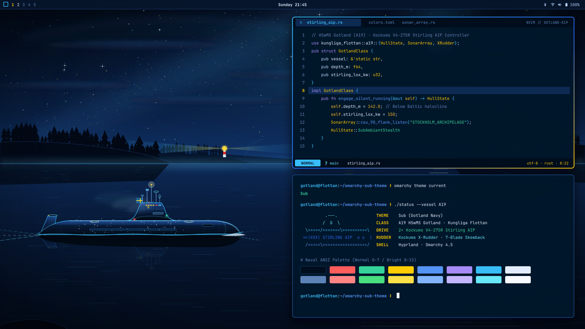
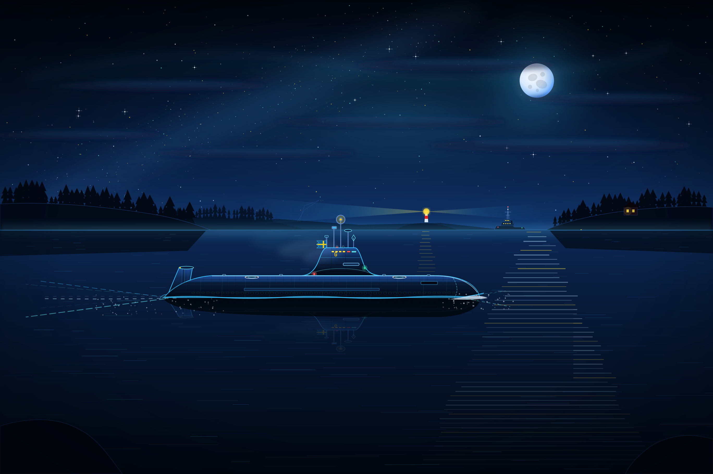
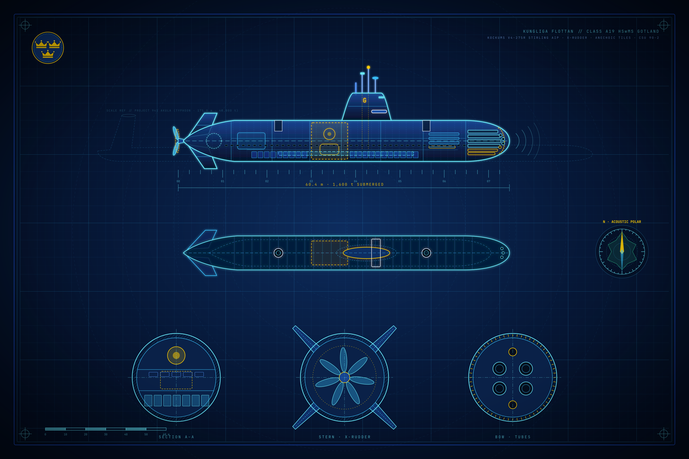
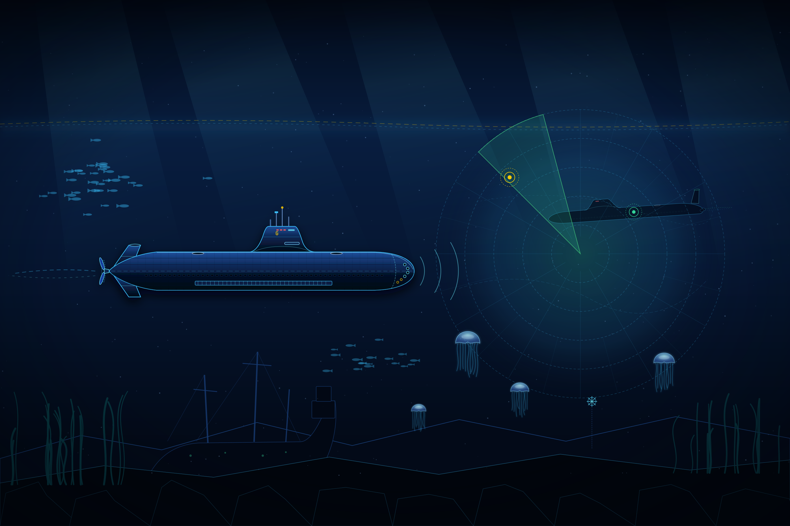
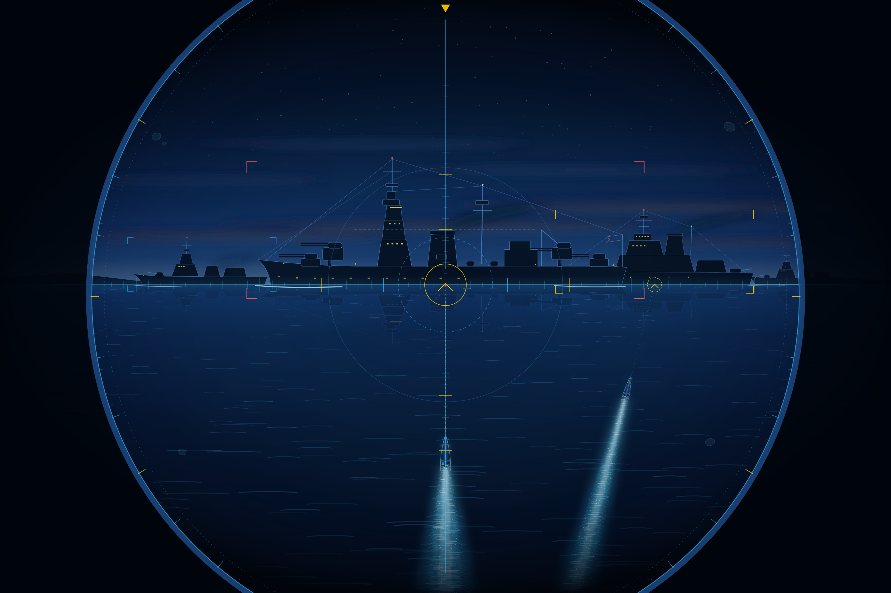

# macOS Sub Theme (`macos-sub-theme`) ⚓🇸🇪

**Swedish Navy (*Kungliga Flottan*) · HSwMS Gotland (A19) · Cold War Bluedark, Sonar Cyan & Swedish Gold — for macOS.**

A native, zero-SIP-modification **macOS** port of [`sgt-nylle/omarchy-sub-theme`](https://github.com/sgt-nylle/omarchy-sub-theme), inspired by [SubWrite](https://subwrite.se), [TechTools](https://techtools.subwrite.se), Sweden's **Gotland-class (A19) Stirling AIP submarine (`HSwMS Gotland`)**, and classic Cold War submarine cinema (*The Hunt for Red October*).

> [!NOTE]
> **No SIP (System Integrity Protection) disabling or private framework injection required.**
> Uses native `osascript` (System Events), user-scoped `defaults write -g` (`NSGlobalDomain`), `.itermcolors` for iTerm2, and drop-in configs for Ghostty, Kitty, Alacritty, and AeroSpace/JankyBorders.

<p align="center">
  
</p>

---

## Repository Structure

```text
macos-sub-theme/
├── backgrounds/
│   ├── 01-stockholm-archipelago-night-patrol.png   # Default: Surfaced Cold War bluedark night patrol
│   ├── 02-hms-gotland-tactical-blueprint.png       # Naval intelligence & engineering blueprint
│   ├── 03-baltic-sonar-silent-running.png          # Silent running below the Baltic halocline
│   └── 04-dawn-torpedo-run.png                     # Attack periscope convoy torpedo salvo
├── configs/
│   ├── ghostty.conf                                # Ghostty theme definition
│   ├── kitty.conf                                  # Kitty color palette
│   ├── alacritty.toml                              # Alacritty TOML color palette
│   └── aerospace-borders.toml                      # JankyBorders / AeroSpace window border snippet
├── Sub-Theme.itermcolors                           # Double-clickable iTerm2 color preset plist
├── apply-theme.sh                                  # Idempotent macOS installer & rollback script
├── preview.png                                     # Palette & desktop showcase
├── LICENSE                                         # MIT License
└── README.md
```

---

## Quick Start

### One-Liner Install (`curl | bash`)

```bash
curl -fsSL https://raw.githubusercontent.com/sgt-nylle/macos-sub-theme/main/apply-theme.sh | bash
```

### Clone & Run Locally

```bash
git clone https://github.com/sgt-nylle/macos-sub-theme.git
cd macos-sub-theme
chmod +x apply-theme.sh
./apply-theme.sh
```

Switch between any of the **4 included `2736×1824` Cold War bluedark wallpapers** at any time:

```bash
# 1 = Stockholm Archipelago Night Departure (Default)
# 2 = HSwMS Gotland Naval Intelligence Blueprint
# 3 = Baltic Thermocline — Silent Running (Hunt for Red October Vibe)
# 4 = Periscope Convoy Torpedo Salvo (Cold War Bluedark Twilight)
./apply-theme.sh --wallpaper 3
```

---

## Four Included Cold War Bluedark Wallpapers (`2736×1824`)

<table>
  <tr>
    <td width="50%" align="center">
      <a href="backgrounds/01-stockholm-archipelago-night-patrol.png">
        
      </a>
      <br><b>01 · Stockholm Archipelago Night Departure (Default)</b>
      <br><i>HSwMS Gotland</i> sailing out on the surface at night in deep Cold War bluedark steel &amp; anechoic tile detail — with free-flooding limber slots, sculpted turtleback sail fairings, white escape-trunk deck rings, cold exhaust mist, a naval escort tug with lattice radar mast, and a silver-blue cratered moon.
    </td>
    <td width="50%" align="center">
      <a href="backgrounds/02-hms-gotland-tactical-blueprint.png">
        
      </a>
      <br><b>02 · HSwMS Gotland (A19) Naval Intelligence Blueprint</b>
      <br>Deep bluedark naval engineering &amp; intelligence plate with internal torpedo reload skids, battery &amp; Stirling AIP compartments, escape trunks, acoustic polar signature rose, a ghosted Cold War Project 941 Typhoon (<i>Red October</i>, 175 m) scale comparison profile, and three cross-sections.
    </td>
  </tr>
  <tr>
    <td width="50%" align="center">
      <a href="backgrounds/03-baltic-sonar-silent-running.png">
        
      </a>
      <br><b>03 · Baltic Thermocline — Silent Running (<i>Hunt for Red October</i> Vibe)</b>
      <br>Deep abyssal bluedark cat-and-mouse scene below the halocline: <i>HSwMS Gotland</i> in full anechoic-tiled stealth trim with red-rigged conn windows and CSU 90-2 flank hydrophone staves pinging a massive Project 941 Typhoon-class submarine lurking in the distant sonar shadow.
    </td>
    <td width="50%" align="center">
      <a href="backgrounds/04-dawn-torpedo-run.png">
        
      </a>
      <br><b>04 · Periscope Convoy Torpedo Salvo (Cold War Bluedark Twilight)</b>
      <br>Attack periscope view in moody Cold War bluedark twilight with optical lens condensation droplets and stadia rangefinding crosshairs locked onto a 4-ship naval surface group as a two-torpedo <i>Torped 62</i> salvo streaks submerged beneath the dark-blue swell.
    </td>
  </tr>
</table>

---

## Color Palette (Extracted from `omarchy-sub-theme/colors.toml`)

| Role | Token | Hex | sRGB (`0.0–1.0`) | Description |
| :--- | :--- | :--- | :--- | :--- |
| **Background** | `background` | `#07162C` | `0.027, 0.086, 0.173` | Deep Baltic Navy CIC Surface |
| **Dark Background** | `black` (`Ansi 0`) | `#040E1D` | `0.016, 0.055, 0.114` | Abyssal Navy Trench |
| **Darker Background** | Tab Bar Scrim | `#020812` | `0.008, 0.031, 0.071` | Keel Black-Navy Scrim |
| **Elevated Surface** | Cursor Guide | `#0F2B52` | `0.059, 0.169, 0.322` | Elevated Navy Card / Cursor Line |
| **Selection** | `selection` / Highlight | `#164682` | `0.086, 0.275, 0.510` | Tactical Navy Selection Highlight |
| **Frame Hairline** | Inactive Border | `#1B457D` | `0.106, 0.271, 0.490` | C64 Navy Frame Hairline |
| **Primary Accent** | `cyan` (`Ansi 6`) | `#38BDF8` | `0.220, 0.741, 0.973` | Periscope & Sonar Telemetry Cyan |
| **Bright Cyan** | `brightCyan` (`Ansi 14`) | `#67E8F9` | `0.404, 0.910, 0.976` | Active Hydrophone Pulse Cyan |
| **Foreground** | `foreground` (`Ansi 7`) | `#E2EEFF` | `0.886, 0.933, 1.000` | Crisp Naval Readout White-Blue |
| **Bright Foreground** | `cursor` (`Ansi 15`) | `#F8FBFF` | `0.973, 0.984, 1.000` | Periscope Glint Peak White (Cursor) |
| **Muted** | `brightBlack` (`Ansi 8`) | `#5B82B8` | `0.357, 0.510, 0.722` | Steel-Navy Comments & Labels |
| **Yellow / Gold** | `yellow` / `brightYellow` | `#FECC02` / `#FDE047` | `0.996, 0.800, 0.008` | Swedish Naval Ensign Gold (*Örlogsflagga*) |
| **Blue** | `blue` / `brightBlue` | `#5494F7` / `#82B5FF` | `0.329, 0.580, 0.969` | Royal Swedish Navy Blue |
| **Green** | `green` / `brightGreen` | `#34D399` / `#4ADE80` | `0.204, 0.827, 0.600` | Passive Sonar Contact Green |
| **Red** | `red` / `brightRed` | `#FF5C5C` / `#FF8585` | `1.000, 0.361, 0.361` | SubWrite Torpedo / Red Alert |
| **Magenta** | `magenta` / `brightMagenta` | `#A78BFA` / `#C4B5FD` | `0.655, 0.545, 0.980` | ESM / Acoustic Intercept Violet |

---

## What `apply-theme.sh` Modifies & How to Reset

1. **System Appearance (`System Events`)**
   - Enables macOS Dark Mode (`set dark mode to true`) and disables auto-switching (`AppleInterfaceStyleSwitchesAutomatically = false`).
2. **Global Accent & Selection Highlight (`NSGlobalDomain`)**
   - `defaults write -g AppleAccentColor -int 4` (Blue/Navy accent)
   - `defaults write -g AppleHighlightColor -string "0.086275 0.274510 0.509804 Blue"` (`#164682` Tactical Navy Selection)
3. **Desktop Wallpaper across All Displays**
   - Sets the chosen `2736×1824` PNG across every connected monitor via `System Events`.
4. **Terminal Emulators**
   - **iTerm2:** Imports `Sub-Theme.itermcolors` (or double-click `Sub-Theme.itermcolors` manually).
   - **Ghostty:** Installs `~/.config/ghostty/themes/sub-theme` and sets `theme = sub-theme` (backs up existing config to `config.subtheme.bak`).
   - **Kitty:** Installs `~/.config/kitty/sub-theme.conf` and appends `include sub-theme.conf` (backs up to `kitty.conf.subtheme.bak`).
   - **Alacritty:** Installs `~/.config/alacritty/sub-theme.toml`.

### Reset to macOS Defaults

```bash
./apply-theme.sh --revert
```

---

## Attribution & Related Projects

- **Original Linux / Omarchy Theme:** [`sgt-nylle/omarchy-sub-theme`](https://github.com/sgt-nylle/omarchy-sub-theme)
- **Windows 11 Port:** [`sgt-nylle/windows-sub-theme`](https://github.com/sgt-nylle/windows-sub-theme)
- **SubWrite (Submarine Typing Game):** [https://subwrite.se](https://subwrite.se) ([`sgt-nylle/subwrite`](https://github.com/sgt-nylle/subwrite))
- **TechTools:** [https://techtools.subwrite.se](https://techtools.subwrite.se) ([`sgt-nylle/techtools`](https://github.com/sgt-nylle/techtools))
- **License:** [MIT License](LICENSE) — Created by [sgt-nylle](https://github.com/sgt-nylle).
